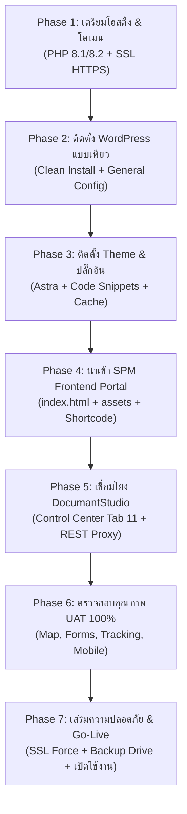

# 🚀 แผนปฏิบัติการขึ้นระบบจริงอย่างละเอียด (Master Deployment Runbook)
## ระบบเว็บพอร์ทัลหลักและศูนย์บริการอิเล็กทรอนิกส์ (SPM GovTech Portal & DocumantStudio Hub)
### สำนักงานเขตพื้นที่การศึกษามัธยมศึกษาสกลนคร (สพม.สกลนคร)

---

> [!IMPORTANT]
> **เป้าหมายของเอกสารฉบับนี้:**  
> เพื่อเป็นคู่มือปฏิบัติการทีละขั้นตอน (Step-by-Step Runbook) ให้ผู้ดูแลระบบสามารถนำโค้ดและระบบที่พัฒนาเสร็จสมบูรณ์ขึ้นสู่เครื่องเซิร์ฟเวอร์จริง (Production Server) ได้อย่างราบรื่น ปลอดภัย ไม่มีข้อผิดพลาด และเชื่อมต่อกับระบบ **DocumantStudio** ได้อย่างสมบูรณ์แบบ 100%

---

## 🗺️ แผนผังภาพรวมกระบวนการขึ้นระบบ (Deployment Workflow)

---

## 📦 Phase 0: สรุปรายการไฟล์และสินทรัพย์ดิจิทัล (Asset Inventory)

ก่อนเริ่มต้น ให้ตรวจสอบว่าท่านมีไฟล์ทั้งหมดเหล่านี้ในเครื่อง (`e:\Design Ai\SPM-Website` และบน [GitHub](https://github.com/linux98/SPM-Website)):

| ชื่อไฟล์ / โฟลเดอร์ | หน้าที่และคำอธิบาย |
| :--- | :--- |
| **`index.html`** | โค้ดหน้าพอร์ทัลหลักและฟังก์ชันทั้งหมด (Map GIS, Cockpit, AI ภูพาน, DocumantStudio Runner) |
| **`mockup.html`** | ไฟล์ตัวอย่างแบบสแตนด์อโลนสำหรับทดสอบออฟไลน์ |
| **`snippet_spm_control_center.php`** | ปลั๊กอิน/สคริปต์ควบคุมหลังบ้าน WP (Tab 11 DocumantStudio, REST API Proxy `/wp-json/spm/v1/track`) |
| **`spm_blueprint_template.json`** | พิมพ์เขียวโครงสร้างการตั้งค่าระบบศูนย์บริการ |
| **`gas/Code.gs`** | โค้ด Google Apps Script ส่งแจ้งเตือน Telegram สำรอง |
| **`assets/kram/`** | ภาพอัตลักษณ์ผ้าย้อมครามเมืองสกลนคร (Hero, Vignette, Weave Tile) |
| **`assets/vendor/leaflet/`** | ไลบรารีแผนที่ Leaflet (JS, CSS, Marker Icons) สำหรับรันแบบ Local High-Performance |

---

## 🛠️ Phase 1: การเตรียม Hosting และ Server (Server Prerequisites)

ก่อนกดติดตั้ง WordPress ให้เข้า Control Panel ของโฮสติ้ง (เช่น DirectAdmin, cPanel หรือ Plesk) และตรวจสอบดังนี้:

1. **การตั้งค่าเวอร์ชัน PHP:**
   * เลือกเป็น **PHP 8.1 หรือ PHP 8.2**
   * ตรวจสอบว่าเปิดใช้งาน Extensions ที่จำเป็นครบถ้วน:
     * `curl` (จำเป็นสำหรับ Server-to-Server REST API Proxy ไปยัง Google Apps Script)
     * `json` (ประมวลผลข้อมูลคำขอและสถิติ)
     * `mbstring` (ประมวลผลฟอนต์และภาษาไทย)
     * `openssl` (ความปลอดภัย HTTPS)
     * `gd` หรือ `imagick` (ประมวลผลรูปภาพ)
2. **การติดตั้งใบรับรองความปลอดภัย SSL (HTTPS):**
   * ไปที่เมนู **SSL Certificates** ใน Hosting
   * ทำการออกใบรับรองฟรี **Let's Encrypt** หรือ **AutoSSL** ให้ครอบคลุมทั้งโดเมนหลักและ `www.`
   * บังคับเปิดตัวเลือก **Force SSL / Redirect HTTP to HTTPS** ทันที
   > [!CAUTION]
   > หากไม่มี HTTPS เบราว์เซอร์จะบล็อก iframe ของ Google Apps Script (`DocumantStudio`) ทันที เนื่องจากข้อกำหนดด้านความปลอดภัย Mixed Content ของเว็บเบราว์เซอร์ยุคใหม่
3. **การสร้างฐานข้อมูล (MySQL / MariaDB):**
   * สร้าง Database ใหม่ เช่น `spm_portal_db`
   * สร้าง Database User และรหัสผ่านที่ปลอดภัย พร้อมผูกสิทธิ์ **ALL PRIVILEGES**

---

## 🌐 Phase 2: ติดตั้ง WordPress แบบเพียว (Clean Installation)

1. **ติดตั้ง WordPress:**
   * ติดตั้งผ่านระบบ 1-Click Installer (เช่น Softaculous / WordPress Manager) หรืออัปโหลดไฟล์ `wordpress.zip` จาก [wordpress.org](https://wordpress.org)
   * เลือก Protocol เป็น **`https://`**
   * เลือกภาษาเป็น **ภาษาไทย (Thai)** หรือ **English** ตามความถนัดของผู้ดูแลระบบ
2. **การตั้งค่าพื้นฐานใน WP-Admin ทันทีหลังติดตั้ง:**
   * **Settings (ตั้งค่า) ➔ General (ทั่วไป):**
     * **Site Title (ชื่อเว็บ):** `สำนักงานเขตพื้นที่การศึกษามัธยมศึกษาสกลนคร`
     * **Tagline (คำโปรย):** `ศูนย์รวมบริการอิเล็กทรอนิกส์และสารสนเทศทางการศึกษา (สพม.สกลนคร)`
     * **WordPress Address (URL):** ต้องเป็น `https://โดเมนของท่าน`
     * **Site Address (URL):** ต้องเป็น `https://โดเมนของท่าน`
     * **Timezone (เขตเวลา):** เลือกเป็น **`UTC+7`** หรือ **`Asia/Bangkok`**
     * **Date Format (รูปแบบวันที่):** `j F Y` (เช่น 24 ตุลาคม 2569)
   * **Settings (ตั้งค่า) ➔ Permalinks (ลิงก์ถาวร):**
     * เลือกเป็น **"Post name" (ชื่อเรื่อง)** เสมอ (`/%postname%/`) แล้วกด Save เพื่อให้ REST API Endpoint ทำงานได้ถูกต้อง
   * **Settings (ตั้งค่า) ➔ Discussion (การสนทนา):**
     * ติ๊กปิดการแสดงความคิดเห็นเริ่มต้น (เพื่อความปลอดภัยและป้องกัน Spam บนเว็บราชการ)

---

## 🎨 Phase 3: ติดตั้ง Theme และ Plugins ที่จำเป็น

### 1. ติดตั้ง Theme (แนะนำ Astra):
1. ไปที่เมนู **Appearance (รูปแบบเว็บ) ➔ Themes ➔ Add New Theme**
2. ค้นหาคำว่า **Astra** ➔ กด **Install** และ **Activate**
3. *ข้อดี:* Astra เป็น Theme ที่เบาที่สุดในโลก โหลดไว ไม่มีโค้ดส่วนเกิน และรองรับโหมด "Canvas / No Header No Footer"

### 2. ติดตั้งปลั๊กอิน (Plugins Checklist):

ไปที่ **Plugins ➔ Add New Plugin** และติดตั้งตามตารางนี้:

| ปลั๊กอิน | ความสำคัญ | วิธีติดตั้ง / การตั้งค่า |
| :--- | :---: | :--- |
| **Code Snippets** | **จำเป็น ⭐** | ค้นหา "Code Snippets" ➔ Install ➔ Activate (ใช้สำหรับรันไฟล์ `snippet_spm_control_center.php`) |
| **Really Simple SSL** | **จำเป็น** | ค้นหา "Really Simple SSL" ➔ กด Activate SSL เพื่อล็อก HTTPS ตลอดทั้งเว็บ |
| **LiteSpeed Cache** หรือ **WP Super Cache** | **แนะนำ** | ช่วยแคชไฟล์ HTML/CSS/JS ทำให้เว็บเปิดติดในเสี้ยววินาที |
| **UpdraftPlus Backup** | **แนะนำ** | สำรองข้อมูลอัตโนมัติขึ้น Google Drive ป้องกันข้อมูลสูญหาย |

---

## 🧩 Phase 4: นำเข้า SPM Control Center & Portal Frontend

### ขั้นตอนที่ 4.1: ติดตั้งโมดูลหลังบ้าน (`snippet_spm_control_center.php`)
1. เข้า WP-Admin ➔ ไปที่เมนู **Snippets ➔ Add New**
2. ตั้งชื่อ Snippet ว่า: `SPM Control Center & DocumantStudio API Bridge`
3. คัดลอกโค้ดทั้งหมดจากไฟล์ [`snippet_spm_control_center.php`](file:///e:/Design%20Ai/SPM-Website/snippet_spm_control_center.php) มาวางลงในช่อง Code
4. ติ๊กเลือกตัวเลือก: **"Run snippet everywhere"**
5. กดปุ่ม **"Save Changes and Activate"**
6. *ผลลัพธ์ที่ได้:* จะมีเมนูใหม่ชื่อ **"SPM Control Center"** ปรากฏขึ้นที่แถบเมนูด้านซ้ายของ WP-Admin ทันที

### ขั้นตอนที่ 4.2: อัปโหลดโฟลเดอร์ Assets ขึ้นโฮสต์
ใช้โปรแกรม FTP (เช่น FileZilla) หรือ File Manager บนโฮสติ้ง:
1. ไปที่โฟลเดอร์รากของ WordPress: `public_html/` (หรือไดเรกทอรีที่ติดตั้ง)
2. อัปโหลดโฟลเดอร์ **`assets`** จากเครื่องของท่านขึ้นไปไว้ที่รากของเว็บ (`public_html/assets/`)
   * ตรวจสอบว่ามีไฟล์ `public_html/assets/kram/...`
   * ตรวจสอบว่ามีไฟล์ `public_html/assets/vendor/leaflet/...`

### ขั้นตอนที่ 4.3: สร้างหน้าแรก (Front Page)
1. ไปที่เมนู **Pages (หน้า) ➔ Add New Page (สร้างหน้าใหม่)**
2. ตั้งชื่อหน้าว่า: **"หน้าหลัก"** หรือ **"Home"**
3. **การตั้งค่า Template ในแถบด้านขวา (Astra Settings):**
   * ที่หัวข้อ **Astra Settings (ไอคอนตัว A มุมขวาบน):**
     * Disable Header: **ติ๊กเลือก (ปิด)**
     * Disable Footer: **ติ๊กเลือก (ปิด)**
     * Content Layout: เลือกเป็น **100% Full Width**
4. **การใส่เนื้อหาพอร์ทัล:**
   * กดปุ่ม `+` เพิ่มบล็อก ➔ ค้นหาบล็อก **Custom HTML**
   * เปิดไฟล์ [`index.html`](file:///e:/Design%20Ai/SPM-Website/index.html) ในเครื่อง ➔ Copy โค้ดทั้งหมด ➔ Paste ลงในบล็อก Custom HTML
   * กดปุ่ม **Publish (เผยแพร่)**
5. **ตั้งค่าให้หน้านี้เป็นหน้าแรกของเว็บไซต์:**
   * ไปที่เมนู **Settings (ตั้งค่า) ➔ Reading (การอ่าน)**
   * ที่หัวข้อ *Your homepage displays* เลือกเป็น **A static page (หน้าที่กำหนดไว้)**
   * ช่อง **Homepage:** เลือกหน้าที่เราเพิ่งสร้าง (เช่น "หน้าหลัก")
   * กดปุ่ม **Save Changes (บันทึกการเปลี่ยนแปลง)**

---

## ⚡ Phase 5: เชื่อมโยง DocumantStudio & ทดสอบ REST API Proxy

1. ไปที่เมนู **"SPM Control Center"** บนเมนูด้านซ้ายของ WP-Admin
2. คลิกไปที่แท็บที่ 11: **"DocumantStudio e-Service Hub"**
3. ตรวจสอบค่าการตั้งค่า:
   * **Web App URL:**  
     `https://script.google.com/macros/s/AKfycbzQJTG5qq-ZH4OJ6XpcMA8_e2cBQmAJjUjRmIvDvywAN0CsGRjIaV0Ibxgj_4bIhWmv/exec`
   * **Embed Mode:** เลือกเป็น **"Modal Window (แนะนำ - แสดงผลในหน้าเว็บเดิม)"**
   * **Proxy Cache TTL:** `60` วินาที
4. กดปุ่ม **"ทดสอบเชื่อมต่อ (Test Ping)"**:
   * ✅ จะต้องแสดงสถานะ **เชื่อมต่อสำเร็จ (Connection Healthy - 200 OK)**
   * แสดงค่าเวลาตอบสนอง (Response Time) เช่น ~350ms
5. **ทดสอบ REST API Proxy ในเบราว์เซอร์:**
   * ลองเปิด URL: `https://โดเมนของท่าน/wp-json/spm/v1/track?code=REQ-2569-000001`
   * จะต้องได้ผลลัพธ์เป็น JSON ตอบกลับมาจาก Google Apps Script โดยไม่มีปัญหา CORS 100%

---

## 🧪 Phase 6: ตรวจสอบคุณภาพระบบก่อนเปิดตัว (Quality Assurance & UAT Checklist)

เปิดหน้าแรกของเว็บไซต์บนเบราว์เซอร์จริง (และบนสมาร์ตโฟน) เพื่อทดสอบหัวข้อต่อไปนี้:

- [ ] **1. ความเร็วและภาพรวม:** หน้าเว็บโหลดติดใน 1-2 วินาที ฟอนต์ Google Sans และ Sarabun แสดงผลคมชัด
- [ ] **2. สลับธีมสี:** ทดสอบกดปุ่มสลับธีม 3 แบบ (ครามหลวง Indigo / มิดไนท์ Midnight / ไฮคอนทราสต์ High-Contrast)
- [ ] **3. ระบบสถิติผู้บริหาร (Cockpit):** กราฟ Chart.js ทั้ง 4 ตัวเรนเดอร์ถูกต้อง สามารถกดสลับฟิลเตอร์ปีการศึกษาได้
- [ ] **4. แผนที่ GIS 8 สหวิทยาเขต:**
  - แผนที่ Google Maps โหลดขึ้นปกติ สามารถสลับโหมดดาวเทียม/ภูมิประเทศได้
  - ปักหมุดโรงเรียน 45 แห่งแสดงผลครบถ้วน
  - กดที่หมุดแสดง Popup รายละเอียดโรงเรียนและปุ่มนำทาง GPS
  - กดปุ่มแท็บสหวิทยาเขตทั้ง 8 แล้วแผนที่จะซูมและไฮไลต์กลุ่มโรงเรียนตามสีประจำเขต
- [ ] **5. ศูนย์บริการอิเล็กทรอนิกส์ (DocumantStudio Integration):**
  - กดปุ่ม **"ยื่นคำร้องออนไลน์"** ใน Header หรือ Hero
  - **Luxury Dual-Ring Spinner** ต้องหมุนสองชั้นอย่างนุ่มนวล พร้อมแสดง % ความคืบหน้า (0% ➔ 100%)
  - เมื่อครบ 100% มีไอคอนเครื่องหมายถูกสีเขียวเด้งขึ้นมา แล้วค่อยๆ เปิดหน้า DocumantStudio
  - ทดสอบกดปุ่ม **"ขอหนังสือรับรองเงินเดือน"** หรือ **"ขอหนังสือรับรอง ก.พ.7"** จาก Service Cards แล้วฟอร์มเปิดตรงตามงานนั้นๆ
- [ ] **6. ระบบติดตามสถานะคำร้อง (Tracking System):**
  - นำรหัสคำขอจริง เช่น `REQ-2569-000022` ไปกรอกค้นหา
  - Visual Stepper 5 ขั้นตอนแสดงสถานะถูกต้อง มีปุ่มดาวน์โหลดเอกสาร PDF (ตราครุฑ) เมื่อสถานะเป็น `READY`
- [ ] **7. แชทบอท AI "น้องภูพาน":**
  - คลิกไอคอนแชทมุมล่างขวา พิมพ์ถามคำถาม เช่น *"ขอหนังสือรับรองเงินเดือนทำอย่างไร"* หรือ *"ติดต่อกลุ่มบุคคลเบอร์อะไร"*
  - น้องภูพานต้องตอบคำถามได้ถูกต้อง พร้อมปุ่มลัดสำหรับเปิดยื่นคำร้อง
- [ ] **8. รองรับหน้าจอมือถือ (Mobile Drawer):**
  - เปิดบนสมาร์ตโฟน กดปุ่ม Hamburger Menu แผงเมนูด้านข้างต้องเลื่อนออกมาอย่างนุ่มนวล และกดเข้าถึงทุกฟังก์ชันได้ครบถ้วน

---

## 🔒 Phase 7: เสริมความปลอดภัยและเปิดใช้งานสาธารณะ (Go-Live)

1. **ปิดการลงทะเบียนสมาชิกทั่วไป:**
   * ไปที่ **Settings ➔ General** ตรวจสอบว่าช่อง *"Anyone can register (ทุกคนสามารถสมัครสมาชิกได้)"* **ไม่ได้ติ๊กเลือก**
2. **ตั้งค่าสำรองข้อมูลอัตโนมัติ (UpdraftPlus):**
   * ไปที่ **Settings ➔ UpdraftPlus Backups**
   * ตั้งเวลาสำรองข้อมูล Files: Weekly (สัปดาห์ละครั้ง), Database: Daily (ทุกวัน)
   * เชื่อมต่อพื้นที่เก็บเข้า Google Drive ของกลุ่ม DLICT เขต
3. **ประชาสัมพันธ์เปิดตัว:**
   * ประกาศแจ้งผู้อำนวยการโรงเรียนทั้ง 45 แห่ง, คณะครู และบุคลากรทางการศึกษา
   * อัปเดตลิงก์พอร์ทัลบนหน้า Facebook เพจสำนักงานเขต และกลุ่มไลน์ผู้บริหาร

---

## 🆘 แผนเผชิญเหตุและวิธีแก้ไขปัญหาที่พบบ่อย (Troubleshooting Guide)

| อาการที่อาจพบ | สาเหตุ | วิธีแก้ไขทันที |
| :--- | :--- | :--- |
| **Iframe หมุนค้าง ไม่ยอมแสดงหน้าเว็บ DocumantStudio** | เว็บไซต์ยังไม่ได้เปิดใช้งาน SSL (HTTPS) หรือโฮสต์บล็อก | ตรวจสอบว่า URL เว็บขึ้นรูปกุญแจเขียว `https://` แล้วหรือไม่ |
| **ค้นหา Tracking Code แล้วขึ้นข้อความ Connection Error** | Server ของโฮสติ้งปิดการใช้งาน cURL หรือติด Firewall | เข้า cPanel ➔ PHP Extensions ➔ ติ๊กเปิด `curl` และ `openssl` |
| **คลิกลิงก์เมนูแล้วขึ้น 404 Not Found** | WordPress ยังไม่ได้รีเฟรชไฟล์ `.htaccess` | ไปที่ *Settings ➔ Permalinks* แล้วกดปุ่ม *Save Changes* อีก 1 ครั้ง |
| **ภาพลายคราม หรือแผนที่ Leaflet ไอคอนหมุดหาย** | ไม่ได้อัปโหลดโฟลเดอร์ `assets` ไปที่รากของเว็บ | ตรวจสอบว่าโฟลเดอร์ `public_html/assets/` มีไฟล์ครบถ้วนตาม Phase 4.2 |

---

> 🏆 **สรุป:** เมื่อดำเนินการตามแผนปฏิบัติการ 7 ขั้นตอนนี้ เว็บไซต์พอร์ทัลของ สพม.สกลนคร จะเปิดให้บริการได้อย่างสมบูรณ์แบบ ทรงคุณค่า เป็นเอกลักษณ์ระดับสากล และพร้อมเป็น **Best Practice ต้นแบบของกระทรวงศึกษาธิการ** อย่างแท้จริงครับ!
