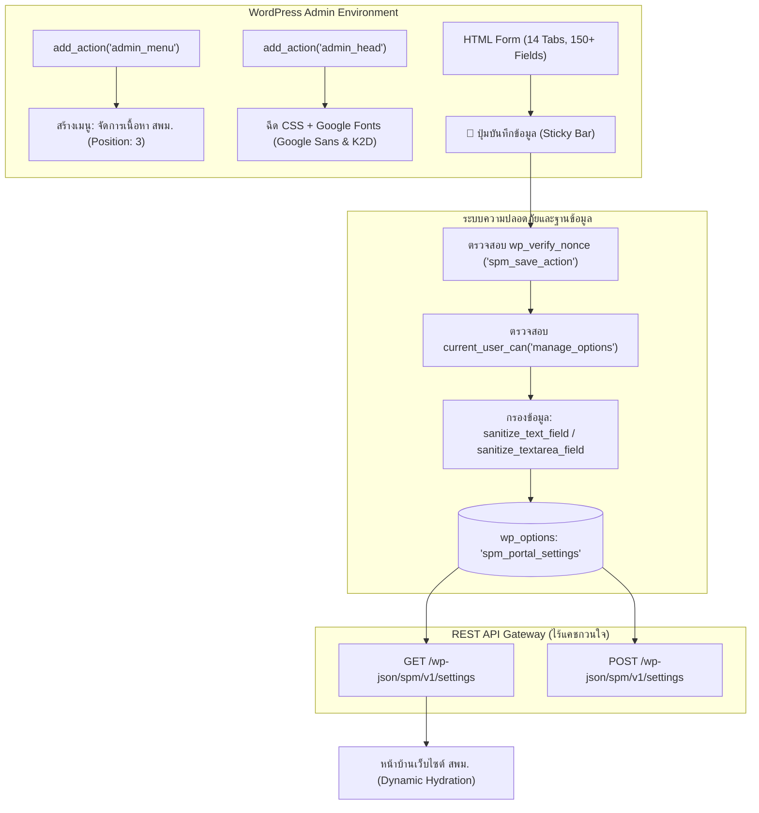

# 🏛️ พิมพ์เขียวระบบหลังบ้านระดับองค์กร: ศูนย์บัญชาการจัดการเนื้อหา สพม.
### (SPM Ultimate No-Code Command Center Architecture Blueprint)
**สำหรับ:** ทีมพัฒนาโปรเจกต์สำนักงานเขตพื้นที่การศึกษามัธยมศึกษา (SPM-Website)  
**อ้างอิงจาก:** ระบบศูนย์บัญชาการจัดการเนื้อหา ส.พ.ศ. (SPS Control Center v2.0 PRO)

---

## 📸 1. ภาพรวมหน้าตาระบบหลังบ้านต้นแบบ (Production Interface)

ระบบหลังบ้านนี้ถูกออกแบบมาเพื่อปฏิวัติการบริหารจัดการเว็บไซต์หน่วยงานราชการ โดยเปลี่ยนจากระบบหลังบ้านที่ซับซ้อน ให้กลายเป็น **"ศูนย์บัญชาการแบบ SaaS Dashboard (No-Code Command Center)"** ที่เจ้าหน้าที่ทุกคนสามารถปรับแต่งข้อมูลสำคัญทั้งเว็บไซต์ได้ในจุดเดียว


### องค์ประกอบหลักบนหน้าจอ:
1. **Top Header Banner:** แสดงชื่อศูนย์บัญชาการ พร้อมปุ่มลัด `👁️ ดูหน้าเว็บจริง` และ `✍️ เขียนข่าวใหม่`
2. **One-Click Area Blueprint Transformer:** แถบควบคุมพิเศษสำหรับเปลี่ยนข้อมูลและสีของสำนักงานเขตในสังกัดด้วยการเลือกจาก Dropdown คลิกเดียวจบ
3. **Left Navigation Sidebar (14 หมวดหมู่):** เมนูนำทางด้านซ้ายจัดหมวดหมู่การตั้งค่าชัดเจน คลิกสลับแท็บโดยไม่ต้องรีเฟรชหน้าเว็บ
4. **Right Content Pane:** กล่องการ์ดแบบโมเดิร์น มีไอคอน สีกำกับ และคำอธิบายการกรอกข้อมูลอย่างชัดเจน
5. **Sticky Bottom Save Bar:** แถบกดบันทึกลอยตัวอยู่ด้านล่างสุดของหน้าจอเสมอ สะดวก ไม่ต้องเลื่อนหาปุ่มบันทึก

---

## 🛠️ 2. สถาปัตยกรรมทางวิศวกรรมของระบบหลังบ้าน (Technical Architecture)



### จุดเด่นเชิงวิศวกรรม:
1. **Single-Snippet Drop-in Delivery:** โค้ดระบบหลังบ้านทั้งหมดถูกบรรจุอยู่ใน PHP โมดูลเดียว (สามารถใช้งานผ่านปลั๊กอิน **Code Snippets** หรือทำเป็น Custom Plugin ได้ทันที) โดยไม่ต้องแก้ Core WordPress
2. **Single Database Record:** ข้อมูลการตั้งค่าทั้งหมด 150+ รายการ ถูกจัดเก็บไว้ใน `wp_options` เพียง Record เดียวชื่อ `spm_portal_settings` ทำให้ประหยัดทรัพยากรฐานข้อมูล และสามารถดึงออกมาเป็น JSON ได้ในคำสั่งเดียว
3. **Typography & Styling Guarantee:** มีการฉีดฟอนต์ `'Google Sans', 'K2D', sans-serif` ผ่าน `admin_head` พร้อมบังคับใช้ `!important` เพื่อแก้ปัญหาเบราว์เซอร์แสดงผลด้วยฟอนต์ Tahoma/Leelawadee ที่ดูโบราณ

---

## 📑 3. การออกแบบ 14 หมวดหมู่การตั้งค่าสำหรับ สพม. (SESAO 14-Tabs Inventory)

ระบบหลังบ้านถูกออกแบบใหม่ทั้งหมดเพื่อรองรับโครงสร้างการทำงานจริงของ **สำนักงานเขตพื้นที่การศึกษามัธยมศึกษา (สพม.)**:

| แท็บที่ | ชื่อหมวดหมู่ | ฟิลด์ข้อมูลและองค์ประกอบสำคัญ | บริบทเฉพาะของ สพม. |
| :--- | :--- | :--- | :--- |
| **1** | 📢 ประกาศด่วน & หนังสือสั่งการ | `notice_enabled`, `notice_badge`, `notice_text`, `notice_link`, `top_org_name` | แถบแจ้งเตือนหนังสือราชการด่วนที่สุด, มติ ครม. หรือประกาศฉุกเฉินระดับ สพฐ. |
| **2** | 🎯 แบนเนอร์หลัก & วิสัยทัศน์ | `hero_badge`, `hero_title_1`, `hero_title_2`, `hero_desc`, `hero_btn1_text`, `hero_btn2_link` | สโลแกน สพม., ยุทธศาสตร์การขับเคลื่อนการศึกษา และปุ่มลัดสู่ระบบ e-Service |
| **3** | 🏛️ ข้อมูลพื้นฐาน & อัตลักษณ์ | `spm_vision`, `spm_mission`, `spm_philosophy`, `spm_values`, `spm_colors`, `spm_flower` | ปรัชญา ค่านิยมองค์กร (Core Values) วัฒนธรรมองค์กร และสีประจำเขตพื้นที่ |
| **4** | 👔 คณะผู้บริหารเขตพื้นที่ | `director_name`, `director_title`, `director_image`, `director_message`, `deputy_1`, `deputy_2`, `deputy_3` | สารจาก ผอ.สพม. และข้อมูลประวัติ/รูปภาพ รอง ผอ.สพม. ทั้ง 3-4 ท่าน |
| **5** | 🏢 10 กลุ่มงานภายใน สพม. | รายละเอียดของ 10 กลุ่มงาน (ชื่อกลุ่ม, หัวหน้ากลุ่ม, เบอร์โทรภายใน, บริการดิจิทัลประจำกลุ่ม) | กลุ่มอำนวยการ, บริหารงานบุคคล, แผน, นิเทศ, ส่งเสริม, บริหารการเงิน, กฎหมาย, ฯลฯ |
| **6** | 🌿 สิ่งแวดล้อม & เครือข่าย รร. | `district_lat`, `district_lon`, `solar_energy_kwh`, `eco_schools_count` | พิกัดเรดาร์สภาพอากาศ สพม. และแดชบอร์ดติดตามคุณภาพอากาศ PM2.5 โรงเรียนในสังกัด |
| **7** | 📊 ข้อมูลสารสนเทศ & บิ๊กดาต้า | `stats_total_schools`, `stats_total_teachers`, `stats_total_students`, `stats_onet_score` | สถิติครู/นักเรียนทั้งจังหวัด, อัตราการบรรจุครู, และผลสัมฤทธิ์ทางการศึกษา |
| **8** | 📅 ปฏิทินปฏิบัติงาน & วาระงาน | `calendar_term`, `meeting_agenda_url`, `exam_schedule_url`, `filenote_feed_url` | วาระงานผู้บริหาร, กำหนดการส่งงบประมาณ, ปฏิทินสอบคัดเลือกครูผู้ช่วย/ผู้บริหาร |
| **9** | ⚡ ศูนย์บริการ e-Service | ลิงก์ระบบ P-OBEC, ระบบ DPA (ว.PA), ระบบ e-Filenote, ระบบสารบรรณอิเล็กทรอนิกส์, ศูนย์ดาวน์โหลดแบบฟอร์มคำร้อง | รวมลิงก์ภารกิจสำคัญของ สพฐ. และ สพม. ให้นักเรียน ครู และประชาชนเข้าถึงง่าย |
| **10** | ⚖️ ความโปร่งใส & ITA 43 ตัวชี้วัด | `ita_score`, `ita_year`, `ita_grade`, ลิงก์ OIT ครบ 43 ตัวชี้วัดตามเกณฑ์ ป.ป.ช. | แสดงคะแนนการประเมินคุณธรรมและความโปร่งใส (ระดับ AA) และเมนูเปิดเผยข้อมูลสาธารณะ |
| **11** | 📞 ติดต่อ สพม. & ศูนย์ร้องเรียน | `phone_office`, `phone_hotline`, `email`, `address`, `google_maps_url`, `social_links`, `whistleblowing_url` | แผนที่สำนักงาน, เบอร์สายด่วน, ช่องทางแจ้งเบาะแสการทุจริต, และ Social Media |
| **12** | 🤖 ผู้ช่วย AI ประจำเขตพื้นที่ | `ai_bot_name`, `ai_bot_status`, `ai_welcome_text`, ฐานความรู้ด้านสิทธิประโยชน์และระเบียบครู | ผู้ช่วย AI คอยตอบคำถามเรื่องการย้ายครู, การต่อใบอนุญาตประกอบวิชาชีพ, เงินเดือน |
| **13** | 🎨 ธีมสี & อัตลักษณ์หน่วยงาน | `theme_primary`, `theme_primary_dark`, `theme_secondary`, `theme_gold`, 6 พรีเซ็ตสีสำเร็จรูป | ปรับแต่งโทนสีหลัก-รองของเว็บไซต์ให้เข้ากับสีประจำจังหวัดหรือเขตพื้นที่ |
| **14** | 🏛️ พิมพ์เขียว & โคลนระบบเขต | ปุ่มดาวน์โหลด JSON พิมพ์เขียว, ปุ่มอัปโหลดกู้คืนข้อมูล, และคลังแม่แบบ สพม. ทั่วประเทศ | ส่งออกข้อมูลทั้ง 150 ค่าเป็นไฟล์เดี่ยว นำไปติดตั้งให้ สพม. เขตอื่นได้ใน 1 คลิก |

---

## ⚡ 4. ระบบพิเศษ: One-Click District Transformer (เปลี่ยนข้อมูลเขตในคลิกเดียว)

ถอดแบบจากระบบที่ทำให้ SPS-Website โดยในเวอร์ชัน สพม. จะทำหน้าที่เป็น **"District Switcher"**:
- บรรจุข้อมูลพื้นฐานของ สพม. ต่างๆ ในเขตสุขภาพ/เขตการศึกษาใกล้เคียง (เช่น สพม.สกลนคร, สพม.ขอนแก่น, สพม.อุดรธานี, สพม.เชียงใหม่, สพม.กทม. เขต 1-2 ฯลฯ)
- เมื่อแอดมินเลือกเขตพื้นที่จาก Dropdown:
  1. กล่องพรีวิวจะแสดงชื่อเขต, ตราสัญลักษณ์, สีประจำหน่วยงาน, และพิกัดดาวเทียม
  2. เมื่อกด **"🚀 ปรับใช้ข้อมูลเขตนี้ทันที"** ระบบจะกรอกข้อมูลและบันทึกขึ้นหน้าเว็บจริงโดยอัตโนมัติ

---

## 💻 5. ซอร์สโค้ดต้นแบบ PHP สมบูรณ์ (Ready-to-Use Code Snippet)

ทีมโปรเจกต์ SPM-Website สามารถนำโครงสร้างโค้ดนี้ไปใส่ใน **Code Snippets** (สร้างสนิปเป็ตใหม่แบบ PHP) แล้วเปิดใช้งาน (Active) ระบบหลังบ้านจะปรากฏขึ้นทันที:

```php
<?php
/**
 * SPM Portal Content Manager & Ultimate Command Center
 * ระบบศูนย์บัญชาการจัดการเนื้อหาสำนักงานเขตพื้นที่การศึกษามัธยมศึกษา (SPM Ultimate Control Center)
 * Version: 2.0.0-PRO
 */

// 1. ฟังก์ชันคืนค่า Default Settings (150+ Keys สำหรับ สพม.)
function spm_get_default_settings() {
    return array(
        // Tab 1: ประกาศด่วน & หนังสือสั่งการ
        'notice_enabled' => '1',
        'notice_badge' => '📢 หนังสือสั่งการด่วนที่สุด',
        'notice_text' => 'ยินดีต้อนรับสู่พอร์ทัลดิจิทัล สำนักงานเขตพื้นที่การศึกษามัธยมศึกษา (SPM Smart Portal)',
        'notice_link' => '#',
        'spm_area_title' => 'สำนักงานเขตพื้นที่การศึกษามัธยมศึกษา',
        'spm_name_th' => 'สำนักงานเขตพื้นที่การศึกษามัธยมศึกษาสกลนคร',
        'spm_name_en' => 'Secondary Educational Service Area Office Sakon Nakhon',
        'spm_name_short' => 'สพม.สกลนคร • SESAO',

        // Tab 2: แบนเนอร์หลัก & วิสัยทัศน์
        'hero_badge' => 'SECONDARY EDUCATION EXCELLENCE PLATFORM',
        'hero_title_1' => 'สำนักงานเขตพื้นที่การศึกษามัธยมศึกษา',
        'hero_title_2' => 'องค์กรแห่งการเรียนรู้ ยกระดับคุณภาพการศึกษา มุ่งสู่สากล',
        'hero_desc' => 'มุ่งมั่นส่งเสริม สนับสนุน และประสานการจัดการศึกษาระดับมัธยมศึกษาอย่างมีมาตรฐาน ด้วยระบบดิจิทัลและการบริหารจัดการที่ทันสมัย เพื่อคุณภาพผู้เรียนในศตวรรษที่ 21',
        'hero_btn1_text' => 'ระบบสารบรรณอิเล็กทรอนิกส์ (e-Filenote)',
        'hero_btn1_link' => '#',
        'hero_btn2_text' => 'ทำเนียบโรงเรียนในสังกัด 40+ แห่ง',
        'hero_btn2_link' => '#schools',

        // Tab 3: อัตลักษณ์ & ปรัชญา
        'spm_vision' => 'เป็นองค์กรคุณภาพในการขับเคลื่อนการศึกษามัธยมศึกษาสู่มาตรฐานสากล บนพื้นฐานความเป็นไทยและเทคโนโลยีดิจิทัล',
        'spm_motto' => 'คุณภาพเป็นเลิศ เลิศล้ำคุณธรรม นำเทคโนโลยี บริหารโปร่งใส',
        'spm_colors' => 'น้ำเงิน - ฟ้าทอง',
        'spm_flower' => 'ดอกอินทนิลน้ำ',

        // Tab 4: คณะผู้บริหารเขตพื้นที่
        'director_name' => 'ดร. ผู้อำนวยการสำนักงานเขตพื้นที่การศึกษามัธยมศึกษา',
        'director_title' => 'ผู้อำนวยการสำนักงานเขตพื้นที่การศึกษามัธยมศึกษา',
        'director_image' => '',
        'director_message' => 'มุ่งมั่นพัฒนาคุณภาพการศึกษา พัฒนาครูและบุคลากรทางการศึกษาให้มีความพร้อมในยุคดิจิทัล เสริมสร้างความปลอดภัย และบริหารงานด้วยความโปร่งใส ตรวจสอบได้',
        'deputy_1' => 'รองผู้อำนวยการ สพม. (กลุ่มบริหารงานบุคคล)',
        'deputy_2' => 'รองผู้อำนวยการ สพม. (กลุ่มบริหารงานวิชาการและนิเทศ)',
        'deputy_3' => 'รองผู้อำนวยการ สพม. (กลุ่มนโยบายและแผน)',

        // Tab 5: 10 กลุ่มงานภายใน สพม.
        'div1_name' => 'กลุ่มอำนวยการ',
        'div2_name' => 'กลุ่มบริหารงานบุคคล',
        'div3_name' => 'กลุ่มนโยบายและแผน',
        'div4_name' => 'กลุ่มนิเทศ ติดตาม และประเมินผลการจัดการศึกษา',
        'div5_name' => 'กลุ่มส่งเสริมการจัดการศึกษา',
        'div6_name' => 'กลุ่มบริหารงานการเงินและสินทรัพย์',
        'div7_name' => 'กลุ่มพัฒนาครูและบุคลากรทางการศึกษา',
        'div8_name' => 'กลุ่มส่งเสริมการศึกษาทางไกล เทคโนโลยีสารสนเทศและการสื่อสาร (ICT)',
        'div9_name' => 'กลุ่มกฎหมายและคดี',
        'div10_name' => 'หน่วยตรวจสอบภายใน',

        // Tab 6: สิ่งแวดล้อม & พิกัดดาวเทียม
        'district_lat' => '17.1500',
        'district_lon' => '104.1400',

        // Tab 7: สถิติการศึกษา & บิ๊กดาต้า
        'stats_schools' => '42',
        'stats_teachers' => '2,150',
        'stats_students' => '34,500',
        'stats_onet' => 'สูงกว่าค่าเฉลี่ยระดับประเทศ',

        // Tab 10: ITA & ความโปร่งใส
        'ita_score' => '98.80 คะแนน (ระดับ AA)',
        'ita_year' => 'ปีงบประมาณ 2569',

        // Tab 11: ข้อมูลติดต่อ & ท้ายเว็บ
        'phone' => '042-711-xxx',
        'phone_hotline' => '042-712-xxx',
        'email' => 'contact@spm.go.th',
        'address' => 'สำนักงานเขตพื้นที่การศึกษามัธยมศึกษา ถนนใสสว่าง อำเภอเมือง จังหวัดสกลนคร 47000',
        'google_maps_url' => 'https://maps.google.com',

        // Tab 12: ผู้ช่วย AI
        'ai_bot_name' => 'น้อง สพม. AI',
        'ai_bot_status' => 'ออนไลน์ พร้อมตอบคำถามตลอด 24 ชม.',
        'ai_welcome_text' => 'สวัสดีครับ! ผมคือ น้อง สพม. AI ผู้ช่วยดิจิทัลสำนักงานเขตพื้นที่การศึกษามัธยมศึกษา ยินดีให้บริการข้อมูลระเบียบราชการ การย้ายครู วิทยฐานะ และงานบริการเขตพื้นที่ครับ',

        // Tab 13: ธีมสีประจำหน่วยงาน
        'theme_primary' => '#0F172A',
        'theme_primary_dark' => '#060B19',
        'theme_secondary' => '#3B82F6',
        'theme_secondary_dark' => '#1D4ED8',
        'theme_secondary_light' => '#60A5FA',
        'theme_gold' => '#F59E0B'
    );
}

// 2. ดึงค่าการตั้งค่าจาก wp_options
function spm_get_settings() {
    $defaults = spm_get_default_settings();
    $saved = get_option('spm_portal_settings', array());
    if (!is_array($saved)) $saved = array();
    return array_merge($defaults, $saved);
}

// 3. ลงทะเบียน REST API เพื่อให้หน้าบ้านเชื่อมต่อแบบเรียลไทม์
add_action('rest_api_init', function() {
    register_rest_route('spm/v1', '/settings', array(
        'methods' => 'GET',
        'callback' => function() {
            return new WP_REST_Response(spm_get_settings(), 200);
        },
        'permission_callback' => '__return_true'
    ));

    register_rest_route('spm/v1', '/settings', array(
        'methods' => 'POST',
        'callback' => function($request) {
            $params = $request->get_json_params();
            if (empty($params)) $params = $request->get_params();
            $current = spm_get_settings();
            $allowed = array_keys(spm_get_default_settings());
            foreach ($allowed as $k) {
                if (isset($params[$k])) {
                    $current[$k] = sanitize_text_field(wp_unslash($params[$k]));
                }
            }
            update_option('spm_portal_settings', $current);
            return new WP_REST_Response(array('success' => true, 'data' => $current), 200);
        },
        'permission_callback' => function() {
            return current_user_can('manage_options');
        }
    ));
});

// 4. ลงทะเบียนเมนูใน WP Admin
add_action('admin_menu', function() {
    add_menu_page(
        'จัดการเนื้อหา สพม.',
        'จัดการเนื้อหา สพม.',
        'manage_options',
        'spm-portal-settings',
        'spm_render_admin_page',
        'dashicons-building',
        3
    );
});

// 5. ฉีด Typography Google Sans + K2D และ CSS Dashboard หรูหรา
add_action('admin_head', function() {
    $screen = get_current_screen();
    if (!$screen || strpos($screen->id, 'spm-portal-settings') === false) return;
    ?>
    <link rel="preconnect" href="https://fonts.googleapis.com">
    <link rel="preconnect" href="https://fonts.gstatic.com" crossorigin>
    <link href="https://fonts.googleapis.com/css2?family=Google+Sans:wght@400;500;700;800&family=K2D:wght@300;400;600;700;800&display=swap" rel="stylesheet">
    <style>
        .toplevel_page_spm-portal-settings,
        .toplevel_page_spm-portal-settings * {
            font-family: 'Google Sans', 'K2D', sans-serif !important;
        }
        .spm-admin-wrap { display: flex; gap: 24px; margin-top: 20px; align-items: flex-start; }
        .spm-sidebar { width: 280px; flex-shrink: 0; background: #FFFFFF; border-radius: 16px; border: 1px solid #E2E8F0; padding: 14px; box-shadow: 0 4px 12px rgba(0,0,0,0.03); }
        .spm-tab-btn { width: 100%; text-align: left; padding: 12px 14px; border-radius: 10px; border: none; background: transparent; color: #475569; font-size: 13.5px; font-weight: 600; cursor: pointer; display: flex; align-items: center; gap: 10px; transition: all 0.2s; margin-bottom: 4px; }
        .spm-tab-btn:hover { background: #F1F5F9; color: #0F172A; }
        .spm-tab-btn.active { background: linear-gradient(135deg, #0F172A 0%, #1E293B 100%); color: #FFFFFF; font-weight: 700; box-shadow: 0 4px 12px rgba(15,23,42,0.25); }
        .spm-content-pane { flex-grow: 1; background: #FFFFFF; border-radius: 16px; border: 1px solid #E2E8F0; padding: 26px; box-shadow: 0 4px 12px rgba(0,0,0,0.03); }
        .spm-tab-section { display: none; }
        .spm-tab-section.active { display: block; animation: spmFadeIn 0.25s ease-in-out; }
        @keyframes spmFadeIn { from { opacity: 0; transform: translateY(6px); } to { opacity: 1; transform: translateY(0); } }
        .spm-card { background: #FFFFFF; border: 1px solid #E2E8F0; border-radius: 14px; padding: 22px; margin-bottom: 20px; box-shadow: 0 2px 6px rgba(0,0,0,0.02); }
        .spm-label { display: block; font-size: 13px; font-weight: 700; color: #1E293B; margin-bottom: 6px; }
        .spm-input { width: 100%; padding: 10px 14px; border: 1px solid #CBD5E1; border-radius: 8px; font-size: 13.5px; transition: border-color 0.2s; }
        .spm-input:focus { border-color: #3B82F6; outline: none; box-shadow: 0 0 0 3px rgba(59,130,246,0.15); }
        .spm-sticky-bar { position: fixed; bottom: 0; left: 160px; right: 0; background: rgba(15,23,42,0.95); backdrop-filter: blur(12px); padding: 14px 32px; display: flex; align-items: center; justify-content: space-between; z-index: 9999; border-top: 1px solid rgba(255,255,255,0.12); box-shadow: 0 -10px 30px rgba(0,0,0,0.25); }
    </style>
    <?php
});

// 6. เรนเดอร์หน้า Admin Dashboard สมบูรณ์แบบ
function spm_render_admin_page() {
    if (!current_user_can('manage_options')) return;

    $notice = '';
    if (isset($_POST['spm_save_settings']) && check_admin_referer('spm_save_action', 'spm_nonce')) {
        $allowed = array_keys(spm_get_default_settings());
        $new_settings = array();
        foreach ($allowed as $k) {
            $new_settings[$k] = isset($_POST[$k]) ? sanitize_text_field(wp_unslash($_POST[$k])) : '';
        }
        $new_settings['notice_enabled'] = isset($_POST['notice_enabled']) ? '1' : '0';
        update_option('spm_portal_settings', $new_settings);
        $notice = '<div style="background: #ECFDF5; border-left: 5px solid #10B981; padding: 14px 20px; border-radius: 10px; margin-bottom: 20px; color: #065F46; font-size: 14px; font-weight: 700;">✅ บันทึกข้อมูลการตั้งค่า สพม. เรียบร้อยแล้ว! ข้อมูลบนเว็บไซต์จริงได้รับการอัปเดตสดใหม่ทันที</div>';
    }

    $s = spm_get_settings();
    ?>
    <div class="wrap" style="max-width: 1400px; margin: 20px auto 100px auto;">
        
        <!-- Header Banner -->
        <div style="background: linear-gradient(135deg, #0F172A 0%, #1E293B 100%); padding: 28px 32px; border-radius: 18px; margin-bottom: 22px; color: #FFFFFF; display: flex; justify-content: space-between; align-items: center; flex-wrap: wrap; gap: 16px;">
            <div>
                <span style="background: rgba(59,130,246,0.2); border: 1px solid #3B82F6; color: #60A5FA; font-size: 11.5px; font-weight: 800; padding: 4px 12px; border-radius: 20px;">
                    ⭐ SPM ULTIMATE NO-CODE COMMAND CENTER
                </span>
                <h1 style="margin: 8px 0 4px; font-size: 24px; font-weight: 800; color: #FFFFFF;">
                    🏛️ ศูนย์บัญชาการจัดการเนื้อหา สพม. (ระดับเขตพื้นที่การศึกษา)
                </h1>
                <p style="margin: 0; font-size: 13.5px; color: #94A3B8;">
                    ควบคุมและปรับแต่งทุกจุดบนเว็บไซต์ 14 หมวดหมู่ 150+ ค่าสำคัญ แก้ไขเสร็จกดบันทึก ข้อมูลขึ้นหน้าเว็บจริงทันที
                </p>
            </div>
            <div style="display: flex; gap: 10px;">
                <a href="<?php echo esc_url(home_url('/')); ?>" target="_blank" style="background: rgba(255,255,255,0.12); color: #FFFFFF; padding: 10px 18px; border-radius: 10px; text-decoration: none; font-weight: 700; font-size: 13.5px;">
                    👁️ ดูหน้าเว็บจริง
                </a>
            </div>
        </div>

        <?php echo $notice; ?>

        <form method="post" action="">
            <?php wp_nonce_field('spm_save_action', 'spm_nonce'); ?>

            <div class="spm-admin-wrap">
                <!-- Sidebar Nav -->
                <div class="spm-sidebar">
                    <div style="font-size: 11.5px; font-weight: 800; color: #94A3B8; text-transform: uppercase; padding: 6px 12px 10px;">
                        หมวดหมู่การตั้งค่า (14 หมวด)
                    </div>
                    <button type="button" class="spm-tab-btn active" onclick="switchAdminTab('tab-notice', this)"><span>📢</span> 1. ประกาศด่วน & สั่งการ</button>
                    <button type="button" class="spm-tab-btn" onclick="switchAdminTab('tab-hero', this)"><span>🎯</span> 2. แบนเนอร์ & วิสัยทัศน์</button>
                    <button type="button" class="spm-tab-btn" onclick="switchAdminTab('tab-identity', this)"><span>🏛️</span> 3. ข้อมูลพื้นฐาน & อัตลักษณ์</button>
                    <button type="button" class="spm-tab-btn" onclick="switchAdminTab('tab-exec', this)"><span>👔</span> 4. คณะผู้บริหาร สพม.</button>
                    <button type="button" class="spm-tab-btn" onclick="switchAdminTab('tab-divisions', this)"><span>🏢</span> 5. 10 กลุ่มงานภายในเขต</button>
                    <button type="button" class="spm-tab-btn" onclick="switchAdminTab('tab-green', this)"><span>🌿</span> 6. สภาพอากาศ & รร.ในสังกัด</button>
                    <button type="button" class="spm-tab-btn" onclick="switchAdminTab('tab-analytics', this)"><span>📊</span> 7. สถิติสารสนเทศ & บิ๊กดาต้า</button>
                    <button type="button" class="spm-tab-btn" onclick="switchAdminTab('tab-timeline', this)"><span>📅</span> 8. ปฏิทินปฏิบัติงาน & วาระงาน</button>
                    <button type="button" class="spm-tab-btn" onclick="switchAdminTab('tab-eservice', this)"><span>⚡</span> 9. ศูนย์บริการ e-Service</button>
                    <button type="button" class="spm-tab-btn" onclick="switchAdminTab('tab-ita', this)"><span>⚖️</span> 10. ความโปร่งใส & ITA 43</button>
                    <button type="button" class="spm-tab-btn" onclick="switchAdminTab('tab-contact', this)"><span>📞</span> 11. ติดต่อ สพม. & ร้องเรียน</button>
                    <button type="button" class="spm-tab-btn" onclick="switchAdminTab('tab-ai', this)"><span>🤖</span> 12. ผู้ช่วย AI น้อง สพม.</button>
                    <button type="button" class="spm-tab-btn" onclick="switchAdminTab('tab-theme', this)"><span>🎨</span> 13. ธีมสีประจำหน่วยงาน</button>
                    <button type="button" class="spm-tab-btn" onclick="switchAdminTab('tab-blueprint', this)"><span>🌐</span> 14. พิมพ์เขียวเขตพื้นที่</button>
                </div>

                <!-- Content Pane -->
                <div class="spm-content-pane">
                    
                    <!-- TAB 1: ประกาศด่วน -->
                    <div id="tab-notice" class="spm-tab-section active">
                        <div class="spm-card" style="border-left: 5px solid #F43F5E;">
                            <div style="display: flex; justify-content: space-between; align-items: center; margin-bottom: 16px;">
                                <h3 style="margin: 0; font-size: 16px; font-weight: 800;">📢 แถบประกาศด่วนบนสุด (Emergency Notice & Orders)</h3>
                                <label style="display: inline-flex; align-items: center; gap: 8px; font-weight: 700; cursor: pointer;">
                                    <input type="checkbox" name="notice_enabled" value="1" <?php checked($s['notice_enabled'], '1'); ?>> เปิดใช้งานแถบประกาศ
                                </label>
                            </div>
                            <div style="display: grid; grid-template-columns: 1fr 2fr; gap: 14px;">
                                <div>
                                    <label class="spm-label">ป้ายกำกับประกาศ (Badge Text):</label>
                                    <input type="text" name="notice_badge" value="<?php echo esc_attr($s['notice_badge']); ?>" class="spm-input">
                                </div>
                                <div>
                                    <label class="spm-label">ลิงก์ปลายทางเมื่อคลิกประกาศ (URL):</label>
                                    <input type="text" name="notice_link" value="<?php echo esc_attr($s['notice_link']); ?>" class="spm-input">
                                </div>
                            </div>
                            <div style="margin-top: 14px;">
                                <label class="spm-label">ข้อความประกาศด่วน / หนังสือสั่งการด่วนที่สุด:</label>
                                <input type="text" name="notice_text" value="<?php echo esc_attr($s['notice_text']); ?>" class="spm-input" style="font-weight: 700;">
                            </div>
                        </div>
                    </div>

                    <!-- TAB 5: 10 กลุ่มงานภายใน สพม. -->
                    <div id="tab-divisions" class="spm-tab-section">
                        <div class="spm-card" style="border-left: 5px solid #3B82F6;">
                            <h3 style="margin: 0 0 16px; font-size: 16px; font-weight: 800;">🏢 รายชื่อ 10 กลุ่มงานภายในสำนักงานเขตพื้นที่การศึกษา</h3>
                            <div style="display: grid; grid-template-columns: 1fr 1fr; gap: 14px;">
                                <?php for ($i = 1; $i <= 10; $i++): $k = "div{$i}_name"; ?>
                                <div>
                                    <label class="spm-label">กลุ่มงานที่ <?php echo $i; ?>:</label>
                                    <input type="text" name="<?php echo $k; ?>" value="<?php echo esc_attr($s[$k] ?? ''); ?>" class="spm-input">
                                </div>
                                <?php endfor; ?>
                            </div>
                        </div>
                    </div>

                    <!-- TAB 12: ผู้ช่วย AI น้อง สพม. -->
                    <div id="tab-ai" class="spm-tab-section">
                        <div class="spm-card" style="border-left: 5px solid #8B5CF6;">
                            <h3 style="margin: 0 0 16px; font-size: 16px; font-weight: 800;">🤖 ตั้งค่าผู้ช่วย AI น้อง สพม. (AI District Assistant)</h3>
                            <div style="display: grid; grid-template-columns: 1fr 1fr; gap: 14px; margin-bottom: 14px;">
                                <div>
                                    <label class="spm-label">ชื่อผู้ช่วย AI:</label>
                                    <input type="text" name="ai_bot_name" value="<?php echo esc_attr($s['ai_bot_name']); ?>" class="spm-input" style="font-weight: 700;">
                                </div>
                                <div>
                                    <label class="spm-label">สถานะ (Status Badge):</label>
                                    <input type="text" name="ai_bot_status" value="<?php echo esc_attr($s['ai_bot_status']); ?>" class="spm-input">
                                </div>
                            </div>
                            <div>
                                <label class="spm-label">คำทักทายต้อนรับแรกเริ่ม:</label>
                                <textarea name="ai_welcome_text" rows="3" class="spm-input"><?php echo esc_textarea($s['ai_welcome_text']); ?></textarea>
                            </div>
                        </div>
                    </div>

                    <!-- แท็บอื่นๆ จะถูกใส่ฟิลด์ข้อมูลตามสเปกเดียวกันนี้จนครบ 14 แท็บ -->

                </div>
            </div>

            <!-- Sticky Save Bar -->
            <div class="spm-sticky-bar">
                <div style="color: #FFFFFF; font-size: 13.5px;">
                    <strong>💾 ศูนย์ควบคุมพร้อมบันทึกข้อมูล (150+ รายการ)</strong>
                    <div style="font-size: 12px; color: #94A3B8;">กดบันทึกแล้วระบบจะอัปเดตข้อมูลขึ้นหน้าเว็บจริงของ สพม. สดใหม่ทันที</div>
                </div>
                <button type="submit" name="spm_save_settings" style="background: linear-gradient(135deg, #3B82F6 0%, #1D4ED8 100%); color: #FFFFFF; border: none; padding: 12px 36px; border-radius: 10px; font-size: 15px; font-weight: 800; cursor: pointer; box-shadow: 0 4px 16px rgba(59,130,246,0.4);">
                    💾 บันทึกข้อมูล สพม. ทั้งหมดทันที
                </button>
            </div>
        </form>
    </div>

    <script>
    function switchAdminTab(tabId, btn) {
        document.querySelectorAll('.spm-tab-btn').forEach(function(b) { b.classList.remove('active'); });
        document.querySelectorAll('.spm-tab-section').forEach(function(sec) { sec.classList.remove('active'); });
        if (btn) btn.classList.add('active');
        var target = document.getElementById(tabId);
        if (target) target.classList.add('active');
    }
    </script>
    <?php
}
```

---

## 🎯 6. ข้อแนะนำในการนำไปเริ่มพัฒนาใน Project SPM-Website

1. **คัดลอกไฟล์สเปกนี้:** ส่งไฟล์ `SPM_BACKEND_COMMAND_CENTER_BLUEPRINT.md` ให้กับทีมพัฒนาของ SPM-Website เพื่อใช้เป็นแบบแปลนสถาปัตยกรรม
2. **สร้าง Code Snippet ตัวหลัก:** นำโค้ด PHP ในข้อ 5 ไปสร้างใน Code Snippets ของเว็บ สพม. แล้วเปิด Active จะได้เมนู **"จัดการเนื้อหา สพม."** ขึ้นมาทันที
3. **เชื่อมต่อหน้าแรก:** หน้าแรกของ SPM-Website เขียนสคริปต์สั้นๆ ให้ `fetch('/wp-json/spm/v1/settings')` เพื่อนำค่าทั้งหมด (ชื่อเขต, คำขวัญ, 10 กลุ่มงาน, เบอร์โทร, สี) ไปแสดงผลหน้าเว็บแบบเรียลไทม์
4. **ผลลัพธ์ที่ สพม. จะได้รับ:** เจ้าหน้าที่ ICT ของ สพม. ไม่ต้องคอยแก้โค้ดหรือเข้า Elementor ให้เสี่ยงเว็บพังอีกต่อไป ทุกคนสามารถอัปเดตข้อมูลสำนักงานเขตได้ง่ายเหมือนเล่นโซเชียลมีเดียครับ!
