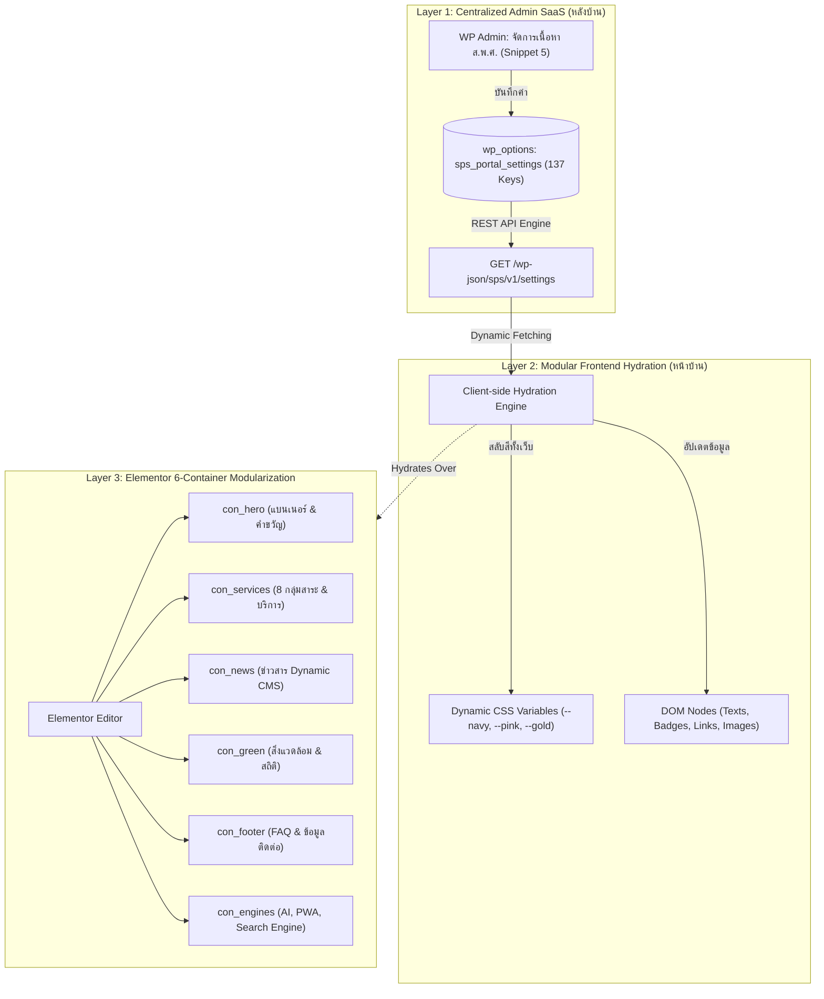
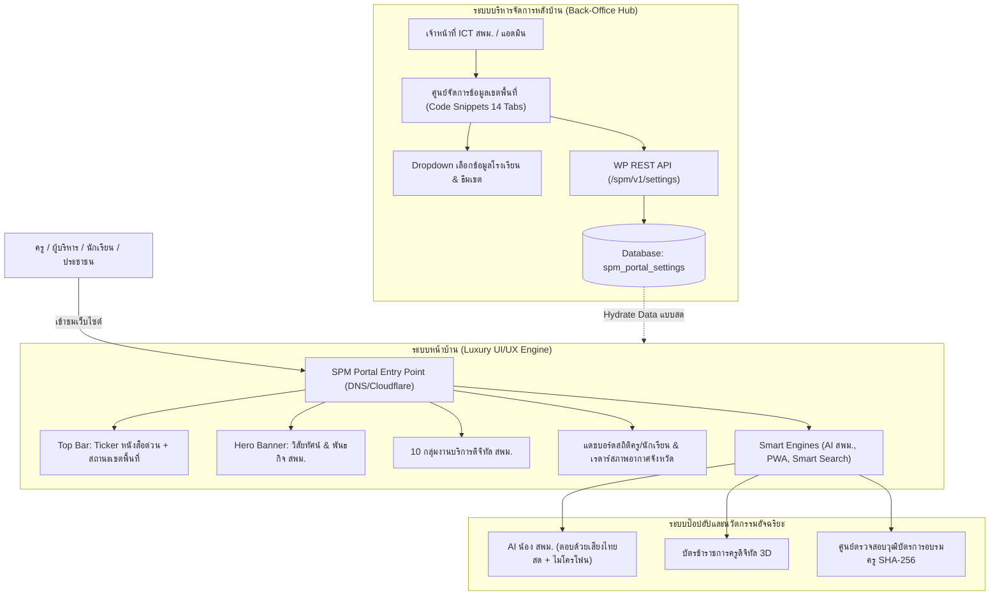

# 🏛️ รายงานสถาปัตยกรรมระบบพอร์ทัลดิจิทัลอัจฉริยะฉบับสมบูรณ์ (Master Blueprint Architecture)
### เพื่อการศึกษา ถอดบทเรียน และปรับใช้กับบริบทของสำนักงานเขตพื้นที่การศึกษามัธยมศึกษา (SPM-Website)

---

## 📑 สารบัญ
1. [บทสรุปสำหรับผู้บริหาร (Executive Summary)](#1-บทสรุปสำหรับผู้บริหาร-executive-summary)
2. [สถาปัตยกรรมโครงสร้าง 3 ประสาน (Triple-Architecture Foundation)](#2-สถาปัตยกรรมโครงสร้าง-3-ประสาน-triple-architecture-foundation)
3. [คลังโมดูลและฟังก์ชันการทำงานทั้งหมด 14 หมวดหมู่ (Feature & Module Inventory)](#3-คลังโมดูลและฟังก์ชันการทำงานทั้งหมด-14-หมวดหมู่)
4. [5 นวัตกรรมระดับตำนาน (Breakthrough Innovations)](#4-5-นวัตกรรมระดับตำนาน-breakthrough-innovations)
5. [ตารางแปลงบริบท: จาก "โรงเรียน" สู่ "สำนักงานเขตพื้นที่การศึกษา" (School to SPM Mapping)](#5-ตารางแปลงบริบท-จาก-โรงเรียน-สู่-สำนักงานเขตพื้นที่การศึกษา)
6. [ไดอะแกรมโครงสร้างและการไหลของข้อมูล (System Data Flow)](#6-ไดอะแกรมโครงสร้างและการไหลของข้อมูล)
7. [โร้ดแมปและข้อเสนอแนะในการนำไปปรับใช้ใน SPM-Website](#7-โร้ดแมปและข้อเสนอแนะในการนำไปปรับใช้ใน-spm-website)

---

## 1. บทสรุปสำหรับผู้บริหาร (Executive Summary)

ระบบพอร์ทัลดิจิทัลนี้ถูกออกแบบและพัฒนาขึ้นภายใต้แนวคิด **"No-Code Command Center & Ultra-Fast Intelligent Portal"** เพื่อแก้ปัญหาดั้งเดิมของเว็บไซต์สถานศึกษาและหน่วยงานภาครัฐ เช่น:
- ต้องพึ่งพาโปรแกรมเมอร์ทุกครั้งที่ต้องการแก้ข้อความหรือเบอร์โทร
- การแก้ไขใน Elementor มักเกิดปัญหาเว็บพัง โหลดช้า หรือข้อมูลสูญหาย
- โครงสร้างเว็บไซต์แยกส่วน ขาดการเชื่อมโยงข้อมูลกับมาตรฐานความโปร่งใส (ITA)
- เว็บไซต์ขาดการมีปฏิสัมพันธ์แบบเรียลไทม์ (Static Web ที่ไม่มีชีวิต)

ระบบนี้จึงถูกรังสรรค์ขึ้นเป็น **"พิมพ์เขียวต้นแบบ (Master Blueprint)"** ที่รวมศูนย์การบริหารจัดการข้อมูล 14 หมวดหมู่ 137 ค่าสำคัญไว้ในจุดเดียว พร้อมระบบสลับอัตลักษณ์โรงเรียนในคลิกเดียว และติดตั้งฟีเจอร์ระดับตำนาน (AI เสียงไทย, ตรวจเกียรติบัตร SHA-256, บัตรดิจิทัล 3D, ตารางระฆังคาบเรียนเรียลไทม์) ซึ่งสามารถนำโครงสร้างทางวิศวกรรมนี้ไปประยุกต์ใช้กับ **สำนักงานเขตพื้นที่การศึกษามัธยมศึกษา (สพม.)** ได้ทันที

---

## 2. สถาปัตยกรรมโครงสร้าง 3 ประสาน (Triple-Architecture Foundation)

ระบบทำงานร่วมกันอย่างสมบูรณ์แบบผ่าน 3 เลเยอร์สถาปัตยกรรม (Triple-Architecture Sync Engine):

### รายละเอียดเลเยอร์สถาปัตยกรรม:
1. **Layer 1 - ศูนย์ควบคุมกลางแบบไม่ต้องแตะโค้ด (No-Code Control Center):**
   - พัฒนาผ่านโมดูลเดี่ยวใน Code Snippets (Snippet ID 5)
   - จัดการข้อมูลทั้งหมด 137 ค่าผ่านหน้าตา UI ระดับ SaaS แยก 14 แท็บ พร้อมฟอนต์ Google Sans และ K2D
   - มี REST API Endpoint (`GET` / `POST` `/sps/v1/settings`) รองรับการเชื่อมต่อกับระบบภายนอก
2. **Layer 2 - ระบบไฮเดรชันไดนามิก (Client-side Hydration & Live Theming):**
   - หน้าเว็บฝั่งผู้ใช้งานดึงข้อมูลจาก Endpoint มาฉีดใส่ DOM แบบเรียลไทม์ ทำให้แก้ข้อความในหลังบ้านแล้วหน้าเว็บเปลี่ยนทันทีโดยไม่ต้องเคลียร์แคช Elementor
   - รองรับ Dynamic Theme Variables: ค่าสีหลัก (Primary), สีรอง (Secondary), และสีทอง (Gold) ถูกผูกกับ CSS Variables ทำให้เปลี่ยนสีทั้งเว็บได้ในเสี้ยววินาที
3. **Layer 3 - การแยกชิ้นส่วน Elementor ออกเป็น 6 กล่องอิสระ (Modular Containers):**
   - ตัดวงจรปัญหา "Elementor ค้าง/พัง" เวลาโหลดหน้า HTML ขนาดใหญ่ โดยหั่นหน้าเว็บออกเป็น 6 Containers ย่อย ทำให้ครูและบุคลากรเปิดแก้ไขชิ้นใดชิ้นหนึ่งได้โดยไม่กระทบส่วนอื่นๆ

---

## 3. คลังโมดูลและฟังก์ชันการทำงานทั้งหมด 14 หมวดหมู่

| หมวดหมู่ (Tab) | ฟังก์ชันและโมดูลย่อย | รายละเอียดการทำงานทางเทคนิค |
| :--- | :--- | :--- |
| **1. ประกาศด่วน & หัวเว็บ (Alert & Header)** | แถบแจ้งเตือนฉุกเฉิน (Emergency Notice Bar), ตราสัญลักษณ์, ชื่อหน่วยงานต้นสังกัด | ควบคุมการเปิด-ปิดได้จากหลังบ้าน, ปรับข้อความ, ลิงก์, และสี Badge กระพริบ |
| **2. แบนเนอร์หลัก & คำขวัญ (Hero Showcase)** | Animated Typography, ปุ่ม Call-to-Action คู่, ชิปอัตลักษณ์ 4 ข้อ | ผูกกับระบบตรวจสอบผลการเรียน DoGrade และหลักสูตรสถานศึกษา |
| **3. อัตลักษณ์ & ปรัชญา (Brand Identity)** | คำขวัญ, ปรัชญาบาลี, วิสัยทัศน์, พันธกิจ, สีประจำโรงเรียน, ต้นไม้ประจำโรงเรียน | แสดงผลในรูปแบบการ์ดเรืองแสงแบบ Glassmorphism |
| **4. คณะผู้บริหาร (Leadership Hub)** | สารจากผู้อำนวยการ, รองผู้อำนวยการ 4 ฝ่าย (วิชาการ, บุคคล, งบประมาณ, ทั่วไป) | แสดงรูปภาพผู้บริหาร, ตำแหน่ง, และข้อความสื่อสารสู่สาธารณะ |
| **5. บริการดิจิทัล 8 เสาหลัก (Smart Services)** | ระบบคัดกรองตามกลุ่มผู้ใช้งาน (นักเรียน, ครู, ผู้ปกครอง, ประชาชน) และ 8 กลุ่มสาระ | Interactive Category Filtering แท็บสลับกลุ่มสาระการเรียนรู้ได้ในหน้าเดียว |
| **6. สวนพฤกษศาสตร์ & Green Campus** | IoT Solar Rooftop Monitoring, ข้อมูลสิ่งแวดล้อม และฐานข้อมูลพรรณไม้ QR Code | จำลองผลการผลิตพลังงานแสงอาทิตย์ การลดการปล่อย CO2 และระบบสแกนต้นไม้ |
| **7. สถิติเปิด & สภาพอากาศ (Analytics & IoT)** | เรดาร์สภาพอากาศดาวเทียมสด & ฝุ่น PM2.5 (Open-Meteo API), สถิติ TCAS, ข้อมูลนักเรียน/ครู | ดึงข้อมูลดาวเทียมเรียลไทม์ตามพิกัด ละติจูด/ลองจิจูด ของสถานศึกษาอัตโนมัติ |
| **8. ปฏิทินปฏิบัติงาน & กิจกรรม (Calendar & Events)** | ปฏิทินกิจกรรมโรงเรียน 4 ภาคการศึกษา, กำหนดการสอบ, กิจกรรมสำคัญ | แสดงผลแบบ Time-Grid และมีลิงก์ดาวน์โหลดกำหนดการ PDF |
| **9. คำถามที่พบบ่อย (Smart FAQ Accordion)** | ระบบตอบคำถามที่พบบ่อย 3 ข้อหลัก (การดูเกรด, การขอใบ ปพ.1/ปพ.7, ข้อมูลติดต่อ) | กล่องเปิด-ปิดแบบ Animated Accordion พร้อมคำแนะนำโดยละเอียด |
| **10. ความโปร่งใส & มาตรฐาน ITA (OIT Hub)** | แดชบอร์ดแสดงผลคะแนนการประเมิน ITA (เช่น 98.50 ระดับ AA) และเมนูเปิดเผยข้อมูลสาธารณะ | สอดคล้องตามเกณฑ์สำนักงาน ป.ป.ช. ครบถ้วนตามมาตรฐานสถานศึกษา |
| **11. ข้อมูลติดต่อ โซเชียล & ท้ายเว็บ (Contact & Footer)** | พิกัด Google Maps แบบฝัง, Hotline ด่วน, รหัสสถานศึกษา 10 หลัก/SMIS/OBEC, ลิงก์โซเชียล 5 แพลตฟอร์ม | แผนที่พิกัดจริง เบอร์โทรกลุ่มงาน และ Social Media (FB, Line, YT, TikTok, IG) |
| **12. ผู้ช่วย AI น้องสกลพัฒน์ (AI Bot Assistant)** | ระบบ AI อัจฉริยะ ตอบคำถาม 24 ชม., คลังคำตอบครอบคลุมงานทะเบียน งานวิชาการ | เชื่อมต่อระบบสั่งการด้วยเสียงและข้อความต้อนรับอัตโนมัติ |
| **13. ธีมสี & เอกลักษณ์โรงเรียน (Theme Customizer)** | พาเลทสี 6 พรีเซ็ตยอดนิยม, ปรับเฉดสี Primary, Secondary, Gold แบบ Custom | ควบคุมตัวแปร CSS Variables ทั้งระบบ แปลงโฉมเว็บไซต์ในคลิกเดียว |
| **14. พิมพ์เขียวโรงเรียน (Master Blueprint Hub)** | ส่งออก (Export) / นำเข้า (Import) ไฟล์ `.json` โครงสร้างข้อมูล 137 ค่า และ 3 แม่แบบมาตรฐาน | สำรองข้อมูลและโคลนนิ่งระบบให้กับโรงเรียนเครือข่ายได้แบบ Turnkey |

---

## 4. 5 นวัตกรรมระดับตำนาน (Breakthrough Innovations)

### 1. Dynamic School Rhythm Engine (เสียงระฆังโรงเรียน & จังหวะสถานศึกษา)
- **กลไกการทำงาน:** ตรวจจับเวลาปัจจุบันของเครื่องผู้ใช้ นำมาเทียบกับตารางเวลา 8 คาบเรียน คำนวณเวลานับถอยหลังสู่ออดคาบถัดไปแบบวินาทีต่อวินาที
- **การแสดงผล:** แสดงผลเป็นแคปซูลเรืองแสงใน Top Bar (เช่น `🔔 คาบที่ 3: กำลังเรียน (เหลืออีก 28 นาที)`) เมื่อคลิกจะเปิด Modal แสดงตารางเวลา 8 คาบพร้อมไฟสถานะสด

### 2. AI Voice & Microphone Recognition Engine (น้องสกลพัฒน์ AI สั่งการด้วยเสียง)
- **กลไกการทำงาน:** ใช้ Web Speech API ทำงาน Native บนเบราว์เซอร์ 100% โดยไม่ต้องเสียค่า API
  - **Speech Synthesis (TTS):** สังเคราะห์เสียงพูดตอบภาษาไทยอย่างเป็นธรรมชาติ
  - **Speech Recognition (STT):** แปลงเสียงพูดภาษาไทยจากไมโครโฟนของผู้ใช้เป็นข้อความคำถามในกล่องแชท

### 3. E-Certificate & Honor Verification Hub (ศูนย์ตรวจสอบเกียรติบัตรดิจิทัล)
- **กลไกการทำงาน:** ตรวจสอบรหัสเกียรติบัตรดิจิทัล พร้อมคำนวณและแสดงผลลายนิ้วมือดิจิทัล (Digital Fingerprint SHA-256 Preview) ป้องกันการปลอมแปลง
- **การแสดงผล:** บัตรเกียรติบัตรโฮโลแกรมเคลือบเงา ตราประทับทองโรงเรียน ชื่อผู้ได้รับรางวัล วันที่ออกบัตร และชื่อผู้อำนวยการผู้ออกบัตร

### 4. Personalized Student Smart ID Card (บัตรประจำตัวนักเรียนดิจิทัล 3D)
- **กลไกการทำงาน:** ค้นหาข้อมูลด้วยเลขประจำตัวนักเรียน แสดงผลบัตรนักเรียนแบบ 3D Interactive Card ที่เอียงและสะท้อนแสงตามตำแหน่งเคอร์เซอร์เมาส์หรือการเอียงหน้าจอมือถือ
- **องค์ประกอบบนบัตร:** รูปประจำตัว, รหัสประจำตัว, ระดับชั้น, บาร์โค้ดดิจิทัล, สถานะการเข้าแถว, และปุ่มลัดเข้าสู่ระบบตรวจผลการเรียน DoGrade

### 5. One-Click School Preset Transformer (ระบบแปลงโฉมโรงเรียนในสังกัด 1 วินาที)
- **กลไกการทำงาน:** บรรจุข้อมูลและพิกัดของ 12 โรงเรียนในสังกัด สพม.สกลนคร ไว้ล่วงหน้า
- **การใช้งาน:** แอดมินเพียงแค่เลือกชื่อโรงเรียนจาก Dropdown ด้านบนสุด แล้วกด **"🚀 แปลงโฉมเว็บไซต์ทันที"** ระบบจะบันทึกข้อมูล เปลี่ยนชุดสี เปลี่ยนพิกัดดาวเทียมอากาศ และเปลี่ยนตัวตน AI ให้กลายเป็นของโรงเรียนนั้นทันทีโดยไม่ต้องใช้ไฟล์ใดๆ

---

## 5. ตารางแปลงบริบท: จาก "โรงเรียน" สู่ "สำนักงานเขตพื้นที่การศึกษา"

เมื่อทีมงานนำพิมพ์เขียวนี้ไปประยุกต์ใช้ในโปรเจกต์ **SPM-Website (สำนักงานเขตพื้นที่การศึกษามัธยมศึกษา)** สามารถปรับเปลี่ยนบริบท (Context Mapping) ได้ดังนี้:

| ฟังก์ชันเดิมของโรงเรียน (School Context) | ฟังก์ชันใหม่ที่ปรับใช้กับ สพม. (SPM District Context) | ประโยชน์และผลลัพธ์ของ สพม. |
| :--- | :--- | :--- |
| **8 กลุ่มสาระการเรียนรู้** | **10 กลุ่มงานภายในสำนักงานเขตพื้นที่การศึกษา** (กลุ่มอำนวยการ, กลุ่มบริหารงานบุคคล, กลุ่มนโยบายและแผน, กลุ่มส่งเสริมฯ, กลุ่มนิเทศฯ, ฯลฯ) | ประชาชนและครูเข้าถึงบริการของแต่ละกลุ่มงานใน สพม. ได้จากหน้าแรกจุดเดียว |
| **ระฆังโรงเรียน & ตาราง 8 คาบ** | **ระบบติดตามหนังสือสั่งการ & วาระงานราชการรายวัน (e-Filenote & Daily Agenda Ticker)** | แสดงหนังสือราชการด่วนที่สุด และกำหนดการประชุมสำคัญของเขตพื้นที่แบบเรียลไทม์ |
| **บัตรนักเรียนดิจิทัล 3D** | **บัตรข้าราชการครูและบุคลากรทางการศึกษาดิจิทัล (Smart Teacher & Staff ID Card)** | บัตรโฮโลแกรมแสดงสังกัด สพม., โรงเรียนที่สอน, วิทยฐานะ, และลิงก์ระบบ P-OBEC / DPA (ว.PA) |
| **ระบบตรวจเกียรติบัตรนักเรียน** | **ระบบตรวจสอบวุฒิบัตรการอบรมครู & รางวัล OBEC AWARDS ระดับเขตพื้นที่** | ครูและบุคลากรสามารถตรวจสอบวุฒิบัตรการผ่านการอบรมจาก สพม. ได้อย่างโปร่งใส |
| **AI น้องสกลพัฒน์ (แชทบอท รร.)** | **AI น้อง สพม. (ผู้ช่วยราชการและสิทธิประโยชน์ครู)** | ตอบคำถามระเบียบการย้ายครู, การประเมินวิทยฐานะ, การสอบบรรจุ, และการเบิกจ่ายสวัสดิการ |
| **เซนเซอร์สภาพอากาศโรงเรียนเดียว** | **แดชบอร์ดคุณภาพอากาศ PM2.5 และความปลอดภัยของโรงเรียนทั้งหมดในสังกัด (District Air & Safety Command)** | มอนิเตอร์สภาพอากาศและความปลอดภัยของโรงเรียนทั้ง 30-40 แห่งในจังหวัด เพื่อสั่งการปิดเรียนกรณีฉุกเฉิน |
| **Dropdown แปลงโฉม 12 โรงเรียน** | **ไดเรกทอรีสารสนเทศและพอร์ทัลเชื่อมโยงโรงเรียนในสังกัด (School Information Portal & Directory)** | ครูและประชาชนสามารถคลิกเลือกลิงก์เข้าสู่เว็บไซต์ ข้อมูลสถิติ และช่องทางติดต่อของทุกโรงเรียนในเขต |
| **คะแนน ITA โรงเรียน (ระดับ AA)** | **ศูนย์รวมข้อมูลความโปร่งใส ITA สำนักงานเขตพื้นที่การศึกษา (OIT 43 ตัวชี้วัด)** | รวมลิงก์เปิดเผยข้อมูลสาธารณะ มาตรการจัดซื้อจัดจ้าง และรายงานความโปร่งใสของ สพม. |

---

## 6. ไดอะแกรมโครงสร้างและการไหลของข้อมูล

---

## 7. โร้ดแมปและข้อเสนอแนะในการนำไปปรับใช้ใน SPM-Website

### ระยะที่ 1: การนำโค้ดและโครงสร้างฐานข้อมูลไปติดตั้ง (Porting Foundation)
1. ติดตั้ง WordPress และปลั๊กอิน Elementor พร้อมปลั๊กอิน Code Snippets บนเซิร์ฟเวอร์ของ สพม.
2. นำโค้ด **Snippet 5** ไปวางในระบบ Code Snippets และเปลี่ยนชื่อ Prefix จาก `sps_` เป็น `spm_`
3. นำโค้ดหน้าแรก **`portal_production.html`** ไปสร้างเป็นหน้าแรก (Front Page) พร้อมแบ่งเป็น 6 Containers ตามโครงสร้างต้นแบบ

### ระยะที่ 2: การปรับบริบทข้อความและหมวดหมู่ (Customization to District Context)
1. ปรับเปลี่ยน **หมวด 5 (บริการ 8 กลุ่มสาระ)** ให้กลายเป็น **10 กลุ่มงานของ สพม.**
2. เปลี่ยนชื่อผู้ช่วย AI เป็น **"น้อง สพม. AI"** พร้อมใส่ฐานข้อมูลคำถาม-คำตอบเกี่ยวกับการย้ายครู, การขอมีและเลื่อนวิทยฐานะ (PA), และการสอบบรรจุ
3. เชื่อมต่อพิกัดภูมิศาสตร์ (Lat/Long) ของที่ตั้งสำนักงานเขตพื้นที่การศึกษา

### ระยะที่ 3: การเชื่อมต่อระบบสารสนเทศระดับเขต (Enterprise Integration)
1. ปรับโมดูล **Student ID** ให้กลายเป็น **ระบบค้นหาและตรวจสอบสถานะวิทยฐานะ/สังกัดของข้าราชการครู**
2. ปรับโมดูล **E-Certificate** ให้เป็น **คลังวุฒิบัตรออนไลน์สำหรับหลักสูตรพัฒนาครูของ สพม.**
3. นำฟังก์ชัน **Dropdown School Presets** ไปใช้เป็นเมนูเปิดดูหน้าสรุปข้อมูลและทำเนียบผู้บริหารของโรงเรียนทั้งหมดในจังหวัด

---
> **เอกสารฉบับนี้ถูกจัดเตรียมขึ้นเพื่อเป็นพิมพ์เขียวอ้างอิงทางเทคนิค (Technical Reference Specification)** สามารถนำเนื้อหาทั้งหมดส่งต่อให้กับทีมพัฒนาระบบ SPM-Website เพื่อใช้เป็นกรอบการออกแบบและพัฒนาต่อไปได้ทันทีครับ 🚀
